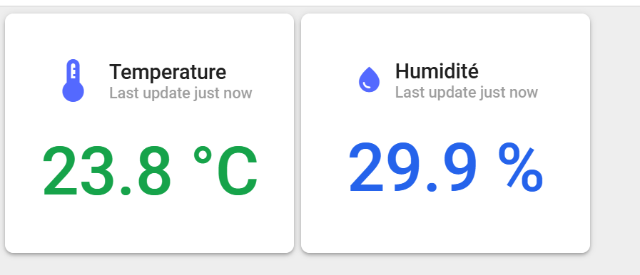
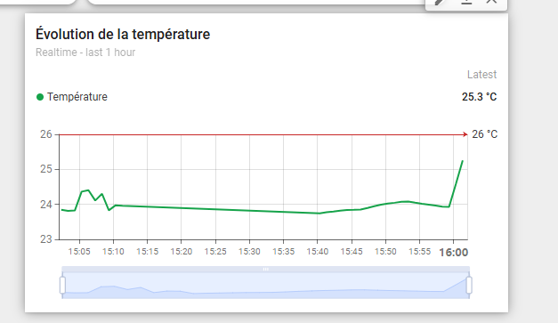
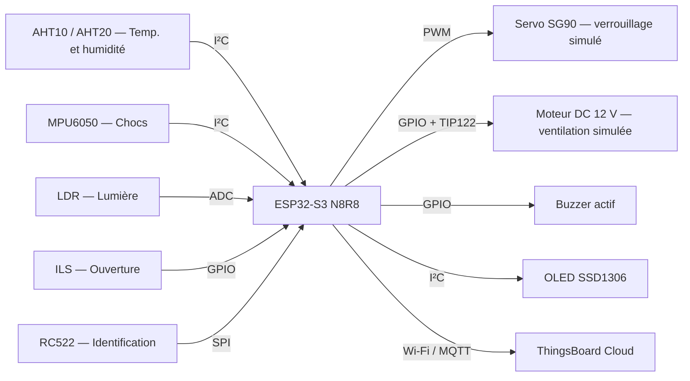

# CargoSafe IoT — Surveillance connectée de colis sensibles

**Projet académique en cours de développement | ESP32-S3 N8R8 · MicroPython · Capteurs · RFID · MQTT · ThingsBoard**

CargoSafe est un prototype de laboratoire conçu pour **surveiller les conditions de transport et détecter des situations anormales** autour d'un colis sensible. Un ESP32-S3 acquiert les mesures de plusieurs capteurs, pilote des sorties de démonstration, affiche l'état sur un écran OLED et transmet des données à ThingsBoard par Wi-Fi/MQTT.

> **Statut : en développement.** Les documents fournis rapportent des essais fonctionnels sur breadboard et les captures montrent des mesures reçues par ThingsBoard. La version V3 de ce dépôt est une **copie de travail** : elle n'a pas été confirmée comme identique au programme actuellement chargé sur le microcontrôleur. Les essais complets et la reproductibilité restent à documenter.

## Aperçu des mesures

<table>
<tr>
<td width="50%"></td>
<td width="50%"></td>
</tr>
</table>

*Captures issues des essais fournis. Elles n'attestent pas à elles seules le fonctionnement continu du système ni de toutes les fonctionnalités de la V3.*

## Fonctions du prototype

| Fonction | Implémentation décrite | État de validation |
|---|---|---|
| Température et humidité | Capteur AHT10/AHT20 sur I²C | Mesures rapportées fonctionnelles ; référence exacte du module à confirmer |
| Détection des chocs | MPU6050 sur I²C | Détection rapportée sur breadboard |
| Exposition lumineuse | LDR sur entrée ADC, surveillée pendant l'ouverture | Lecture rapportée ; seuil à calibrer |
| Ouverture d'un colis | Contact ILS + aimant | Détection rapportée sur breadboard |
| Contrôle d'accès | Lecteur RFID RC522 + servo SG90 | Lecture et rotation rapportées ; **verrouillage mécanique simulé** |
| Alerte sonore | Buzzer actif | Dans V3 : intrusion ou forte lumière durant l'ouverture |
| Ventilation expérimentale | Moteur CC 12 V commandé par TIP122 | Démarrage sur seuil thermique rapporté ; **ne refroidit pas activement** |
| Affichage local | OLED SSD1306 128×64 | Fonctionnement rapporté ; adresse I²C `0x3D` |
| Supervision à distance | Wi-Fi + MQTT + ThingsBoard | Captures de télémétrie disponibles ; indicateurs complets à finaliser |

**Logique de la V3 :** température ≥ **26 °C** → commande du moteur ; carte RFID autorisée → servo à **150°** et fenêtre d'ouverture de **20 s** ; ouverture non autorisée → intrusion mémorisée ; lumière forte pendant l'ouverture → alarme. Ces valeurs sont celles du code fourni, non des performances certifiées du dispositif.

## Architecture

L'architecture représente le montage documenté. Le moteur et le servo sont des **démonstrateurs fonctionnels**, pas un dispositif commercial de contrôle de température ou de sécurité.

## Technologies

`MicroPython` · `ESP32-S3` · `I²C` · `SPI` · `ADC` · `PWM` · `RFID` · `Wi-Fi` · `MQTT` · `ThingsBoard` · `Thonny`

## Fichiers à consulter

| Fichier | Description |
|---|---|
| [`src/CargoSafe_IoT_ThingsBoard_V3.py`](src/CargoSafe_IoT_ThingsBoard_V3.py) | Version intégrant surveillance locale et télémétrie MQTT ; **pas encore confirmée comme version finale sur la carte** |
| [`src/CargoSafe_IoT_local_v2.py`](src/CargoSafe_IoT_local_v2.py) | Version de développement local antérieure au MQTT |
| [`src/CargoSafe_IoT_local.py`](src/CargoSafe_IoT_local.py) | Première version locale conservée pour suivre l'évolution du projet |
| [`config/config_reseau.example.py`](config/config_reseau.example.py) | Exemple de configuration réseau, **sans vrais identifiants** |
| [`docs/INSTALLATION_THONNY.md`](docs/INSTALLATION_THONNY.md) | Comment préparer l'ESP32-S3 avec Thonny et les dépendances manquantes |
| [`docs/brochage.md`](docs/brochage.md) | Brochage utilisé pour les essais |
| [`docs/MATERIEL_ET_ECARTS.md`](docs/MATERIEL_ET_ECARTS.md) | Composants de la V3 et différences avec la liste initiale |
| [`docs/tests.md`](docs/tests.md) | Résultats d'essais rapportés |
| [`docs/PLAN_VALIDATION.md`](docs/PLAN_VALIDATION.md) | Vérifications à documenter pour consolider le prototype |
| [`thingsboard/telemetrie.md`](thingsboard/telemetrie.md) | Clés publiées dans ThingsBoard |
| [`hardware/components/CargoSafe_IoT_Liste_Composants.xlsx`](hardware/components/CargoSafe_IoT_Liste_Composants.xlsx) | Liste de composants **préliminaire** (certaines références divergent du code V3) |

## Reproduction et sécurité

Ce dépôt **n'est pas encore un kit prêt à flasher tel quel**. Pour exécuter la V3, il manque l'export de la version réellement utilisée sur le microcontrôleur ainsi que plusieurs bibliothèques MicroPython (`mfrc522.py`, `mpu6050.py`, `ssd1306.py`) à fournir selon leurs licences. La configuration réseau doit rester **privée**.

Voir les [instructions d'installation](docs/INSTALLATION_THONNY.md) et les [précautions électriques](docs/brochage.md). Le moteur 12 V et le servo doivent être alimentés par des circuits adaptés ; leurs courants ne doivent pas transiter par les GPIO de l'ESP32-S3.

## Limites et prochaines étapes

- Confirmer la référence exacte du capteur AHT et la version du programme réellement exécutée.
- Ajouter les **photos réelles** du montage et un schéma électrique final.
- Finaliser les indicateurs du tableau de bord (RFID, intrusion, lumière, chocs et actionneurs).
- Documenter les essais de robustesse : coupures Wi-Fi, redémarrages, bruit des capteurs et alimentation.
- Relever des résultats mesurés et les consigner dans le [plan de validation](docs/PLAN_VALIDATION.md).

*Projet en développement — les résultats sont décrits avec les limites des éléments actuellement disponibles.*
